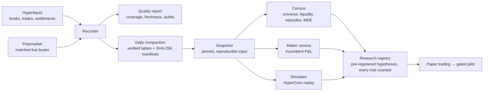

# Keel

**Open-source, self-hosted quantitative research and trading system for Outcome (HIP-4) prediction markets on Hyperliquid.**

[](https://github.com/gsoffmarket/keel/actions/workflows/ci.yml)
[](LICENSE)


Keel records Outcome's order books, trades and settlements together with matched Polymarket prices, turns them into verified research datasets, and measures which trading strategies can actually make money after fees, latency and competition, before any capital is put at risk.

## What Keel is

Keel is a research-first quant system for [Outcome](https://outcome.xyz), the HIP-4 prediction-market platform built on Hyperliquid. It runs on your own machine or server and covers the full path from market data to evidence:

- a **market-data recorder** for every live Outcome market: order books at block resolution, trades with both counterparties, official settlements, and live Polymarket reference prices for the same events;
- a **data-quality layer** that measures coverage, freshness and correctness of everything recorded;
- a **research engine** that sizes the opportunity (market census), measures existing market makers' profitability, computes the smallest edge each strategy could reliably detect, and replays strategies through a HyperCore-accurate simulator;
- a **research registry** that pre-registers every hypothesis and records every test run, so results can't be cherry-picked.

The full system adds fair-value models, an opportunity scanner, paper trading, a hardened signer and a dashboard, delivered milestone by milestone.

## The problem it solves

Prediction markets on Hyperliquid are new, fast and thin. Traders and builders face three problems:

1. **No research-grade data.** Outcome's public feeds are live-only. Without a recorder there is no history of books, trades or settlements to study, and no way to know whether a dataset has gaps.
2. **No way to tell a real edge from noise.** A price gap between Outcome and Polymarket looks like free money until fees, latency, queue position and stale quotes are accounted for. Most backtests ignore these and overstate results.
3. **No discipline around testing.** Trying many ideas on the same data and keeping the best one produces false discoveries.

Keel solves these with a verified recorder, an exchange-accurate simulator checked against real fills, statistical power calculations before any test starts, and a registry that counts every trial.

## How it works



1. **Record.** The recorder streams Outcome books (per block for active sports and price markets), trades, mids and perp marks, polls the market list, captures official settlement results, and subscribes to the matching Polymarket books. Raw messages are stored verbatim, append-only.
2. **Verify.** Every session produces a quality report: minute-level coverage, REST audits of the WebSocket books, mirror checks, settlement capture and reference freshness. Stale reference prices are flagged and can never feed research.
3. **Compact.** Each day becomes research tables (Parquet or gzip JSON lines) with row counts and SHA-256 hashes in a manifest that is checked before use.
4. **Research.** Analyses run on immutable snapshots. The census and maker census describe the market; the MDE table says which edges are detectable; the simulator replays strategies with real latency, fees and queue rules.
5. **Decide.** Hypotheses are registered with their thresholds fixed in advance. Simulation can reject a strategy; only prospective paper trading and a gated pilot can promote one.

## Key features

| Area | Capability |
| --- | --- |
| Recording | Outcome-only by default; per-block books for active sports and price markets with automatic activity tiering; trades with buyer and seller; official settlements; auto-restart, reconnect with backoff, stall detection |
| Reference prices | Automatic Outcome↔Polymarket event matching with confidence scores; live Polymarket books with exchange and receipt timestamps, feed age and change age |
| Data quality | Coverage, audits, mirror checks, settlement capture, freshness, suspect-mapping detection, per-source storage accounting, daily reports |
| Operations | Disk budget and retention that only delete verified data, health pings, a read-only Health page, host benchmark, systemd and launchd units |
| Research | Reproducible snapshots, S1a census, S1b maker census, minimum-detectable-edge maths, HyperCore replay simulator, evaluators, research registry |
| Validation | `keel research validate` checks the engine against ground truth on real data |
| Engineering | Pure Python standard library at runtime, fixed-point money and prices, deterministic byte-identical reports, CI on Python 3.9–3.13 |

## Verified results

Measured on recorded Outcome mainnet data with `keel research validate`:

- **Simulator accuracy:** replaying real aggressive orders against the book recorded just before them, the simulator reproduced the exchange's fill size and price for **95.8%** of orders that met a book under one second old (89.6% across all recorded orders).
- **Accounting:** profit and loss across 525 trading addresses and 24,879 trades summed to minus total fees with a residual of **$0.000000**.
- **Edge detection:** a planted 1.855¢ edge was measured as **1.849¢**; a market with no edge measured −0.144¢, the cost of the spread plus fees.
- **Reproducibility:** the same snapshot gives byte-identical census reports and simulator replays.

## How it is built

- **Milestones gated by evidence.** Each milestone is accepted on measured results from real data, not on passing tests alone.
- **Read-only first.** Recording and research need no keys and place no orders; trading components arrive later behind a ten-condition gate and explicit owner approval.
- **Reproducible by construction.** Raw data is never edited, tables are hashed, analyses are pinned to snapshots, and reports are deterministic.
- **Statistics before strategies.** Every hypothesis states its mechanism, primary statistic, budget and minimum detectable edge before it runs.
- **Tested against reality.** Unit and end-to-end tests run the real recorder against local stand-ins fed with captured mainnet payloads; validation compares outputs with real exchange fills.

| Milestone | Scope | State |
| --- | --- | --- |
| M0 | Recorder, quality reports, compaction, operations, Health page | ✅ Built |
| M1 | Snapshots, censuses, MDE, simulator, registry, validation | ✅ Built |
| M2 | Fair value, opportunity scanner, paper-trading engine | Next |
| M3 | Hardened signer and conformance tests | Planned |
| M4 | Dashboard | Planned |
| M5–M6 | Prospective paper trading, gated pilot | Planned |

## Quick start

Requires Python 3.9 or newer. No other dependencies.

```bash
git clone https://github.com/gsoffmarket/keel.git
cd keel
python3 -m venv .venv && . .venv/bin/activate
pip install -e ".[dev]"            # add ,parquet for Parquet tables

keel init                          # writes keel.json and creates data/
keel doctor                        # checks Python, disk, clock and connectivity
keel record --duration 30m         # records live Outcome and Polymarket data
```

While it records, in another terminal:

```bash
keel status                        # live counters
keel health                        # Health page at http://127.0.0.1:8787
```

## Reproduce the results

**1. Run the test suite (no network needed).**

```bash
python -m pytest
```

This runs the recorder end to end against local exchange stand-ins fed with real captured payloads, and checks the research engine on constructed markets with known answers, including planted-edge recovery.

**2. Record real data.** Record for at least 30 minutes; for research-grade numbers, record continuously for 7 days on an always-on host (see [Run it anywhere](#run-it-anywhere)).

```bash
keel record --duration 30m
keel quality                       # data-quality report in data/reports/
```

**3. Build the research tables and run the analyses.**

```bash
keel compact --all                 # verified daily tables in data/tables/
keel research census               # reports/census/census-<snapshot>.md
keel research makers               # reports/census/makers-<snapshot>.md
keel research validate             # reports/validation/validation-<snapshot>.md
```

**4. Verify a report reproduces byte for byte.**

```bash
keel research census --verify data/reports/census/census-<snapshot>.json
```

**5. Register and test a hypothesis.**

```bash
keel research mde --per-week 50,100 --test-days 45,90
keel research register o-s7-l.json            # refused if the edge is undetectable
keel research run O-S7-L --evaluator reference_gap_taker --seed 1
keel research list
```

See [docs/research.md](docs/research.md) for the registration spec format and evaluator settings.

## Run it anywhere

| Where | How |
| --- | --- |
| Laptop (macOS or Linux) | `keel record`; on macOS, `deploy/launchd/` keeps it running |
| Linux server or VPS | `deploy/systemd/` units for the recorder and the daily job; benchmark the host first with `keel bench --duration 30m` |
| Remote monitoring | `ssh -L 8787:127.0.0.1:8787 user@server`, then open the Health page locally |

Full instructions: [deploy/README.md](deploy/README.md) and [docs/recorder.md](docs/recorder.md).

## Command reference

| Command | Purpose |
| --- | --- |
| `keel init` / `keel doctor` | Create config; check the environment and connectivity |
| `keel record` / `keel status` / `keel health` | Record; live status; Health page |
| `keel quality` / `keel compact` | Data-quality report; daily research tables |
| `keel retain` / `keel daily` / `keel bench` | Retention; daily job; host benchmark |
| `keel research census` / `makers` / `mde` | Market census; maker census; detectable-edge table |
| `keel research validate` | Ground-truth validation of the research engine |
| `keel research register` / `run` / `verdict` / `list` / `show` | Research registry |

## Project structure

```
src/keel/
  hl/          Hyperliquid: coin encoding, outcomeMeta parsing, info client, WebSocket client
  refs/        Polymarket matching, live reference books, freshness, alignment
  recorder/    recorder process and append-only raw storage
  research/    snapshots, censuses, MDE, simulator, registry, evaluators, validation
  compact.py   daily research tables        quality.py   data-quality report
  ops.py       retention, disk budget, daily job, benchmark        health.py   Health page
deploy/        systemd and launchd units
docs/          operator and research guides
tests/         unit, end-to-end and safety-invariant tests
```

## Documentation

- [Recorder guide](docs/recorder.md): configuration, operation, storage and resource use
- [Data quality](docs/data-quality.md): every metric in the quality report
- [Reference feeds](docs/references.md): Polymarket matching and the freshness rule
- [Research engine](docs/research.md): snapshots, censuses, MDE, simulator, registry, evaluators and validation
- [Deployment](deploy/README.md)

## Contributing and security

Contributions are welcome; see [CONTRIBUTING.md](CONTRIBUTING.md) and the [code of conduct](CODE_OF_CONDUCT.md). Report security issues privately as described in [SECURITY.md](SECURITY.md). Release notes are in [CHANGELOG.md](CHANGELOG.md).

Keel is research software; nothing in this repository is investment advice.

## License

[Apache License 2.0](LICENSE)
